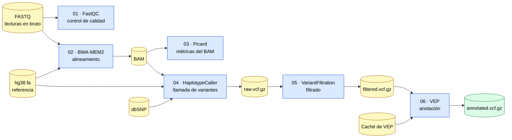

# IPC-2026
proyecto ejemploIPC 2026
 ## Estos es un subtiutlo 
 Cambio en rama secundaria 
 

> [!WARNING]
> **Proyecto docente: simulación con fines exclusivamente académicos.**
>
> Este repositorio se ha creado para la asignatura _Introducción a la Programación Científica_ del Máster en Bioinformática de la UNIR, con el objetivo de practicar el uso de Git y GitHub. **No es un pipeline funcional ni validado.**
>
> Los scripts son esqueletos (pueden estar vacíos) y los resultados son ficheros de ejemplo. **No debe usarse para análisis científicos ni clínicos.**


[](https://www.ncbi.nlm.nih.gov/datasets/genome/GCF_000001405.26/)
[](data/)

[](https://docs.conda.io/en/latest/)
[](scripts/)

[](LICENSE)




## Instalación

### Requisitos

- [Conda](https://docs.conda.io/) (o [Miniconda](https://docs.conda.io/en/latest/miniconda.html))
- Se recomienda usar Linux (algunas herramientas, como BWA-MEM2, están pensadas para Linux x86_64 )
- Espacio en disco para la referencia, la caché de VEP y los resultados (varios GB por muestra)

### Pasos

1. Clona el repositorio:

   ```bash
   git clone https://github.com/<usuario>/wgs-germline-variant-calling-IPC-2026.git
   cd wgs-germline-variant-calling-IPC-2026
   ```

2. Crea el entorno con todas las herramientas:

   ```bash
   conda env create -f envs/environment.yml
   ```

3. Actívalo:

   ```bash
   conda activate wgs-germline-variant-calling
   ```

4. Comprueba que las herramientas están disponibles:

   ```bash
   fastqc --version
   bwa-mem2 version
   samtools --version
   gatk --version
   vep --help
   ```

## Preparación de los datos

Los datos no se incluyen en el repositorio (ver [`data/`](data/)). Antes de ejecutar el pipeline hay que:

1. Colocar los FASTQ de cada muestra en `data/raw/`.
2. Descargar el genoma hg38 en `data/reference/` y generar sus índices:

   ```bash
   samtools faidx data/reference/hg38.fa
   gatk CreateSequenceDictionary -R data/reference/hg38.fa
   bwa-mem2 index data/reference/hg38.fa
   ```

3. Descargar dbSNP y la caché de VEP en `data/reference/`:

   ```bash
   vep_install -a cf -s homo_sapiens -y GRCh38 -c data/reference/vep_cache
   ```

4. Definir las muestras en `config/samples.tsv` y las rutas en `config/config.yaml`
   (ver [Configuración](#configuración)).

## Uso

> [!NOTE]
> En esta versión los scripts son esqueletos, así que los comandos siguientes muestran **cómo se ejecutaría el pipeline**, no producen resultados reales.

Los scripts se ejecutan **desde la raíz del repositorio**, en orden, y reciben el identificador de la muestra (`sample_id`) como argumento:

```bash
SAMPLE=sample1

bash scripts/01_fastq_qc.sh          $SAMPLE   # control de calidad de las lecturas
bash scripts/02_alignment.sh         $SAMPLE   # alineamiento contra hg38
bash scripts/03_bam_qc.sh            $SAMPLE   # métricas del alineamiento
bash scripts/04_variant_calling.sh   $SAMPLE   # llamada de variantes
bash scripts/05_variant_filtering.sh $SAMPLE   # filtrado de variantes
bash scripts/06_annotation.sh        $SAMPLE   # anotación con VEP
```

Para procesar todas las muestras de `config/samples.tsv`:

```bash
tail -n +2 config/samples.tsv | cut -f1 | while read -r SAMPLE; do
    for script in scripts/0*.sh; do
        bash "$script" "$SAMPLE"
    done
done
```

### Salidas esperadas

Tras ejecutar el pipeline con `sample1`, se generarían:

| Paso | Fichero | Carpeta |
|---|---|---|
| 01 | `sample1_R1_fastqc.html`, `sample1_R2_fastqc.html` | `results/qc/` |
| 02 | `sample1.bam`, `sample1.bam.bai` | `results/bam/` |
| 03 | `sample1_metrics.txt` | `results/qc/` |
| 04 | `sample1.raw.vcf.gz` | `results/vcf/` |
| 05 | `sample1.filtered.vcf.gz` | `results/vcf/` |
| 06 | `sample1.annotated.vcf.gz` | `results/vcf/` |

El resultado final es `results/vcf/sample1.annotated.vcf.gz`.
