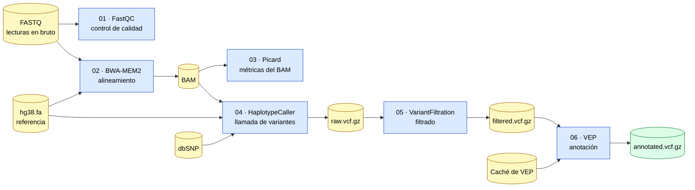

# IPC-2026
proyecto ejemploIPC 2026
 ## Estos es un subtiutlo 
 Cambio en rama secundaria 
 

> [!WARNING]
> **Proyecto docente: simulación con fines exclusivamente académicos.**
>
> Este repositorio se ha creado para la asignatura _Introducción a la Programación Científica_ del Máster en Bioinformática de la UNIR, con el objetivo de practicar el uso de Git y GitHub. **No es un pipeline funcional ni validado.**
>
> Los scripts son esqueletos (pueden estar vacíos) y los resultados son ficheros de ejemplo. **No debe usarse para análisis científicos ni clínicos.**

